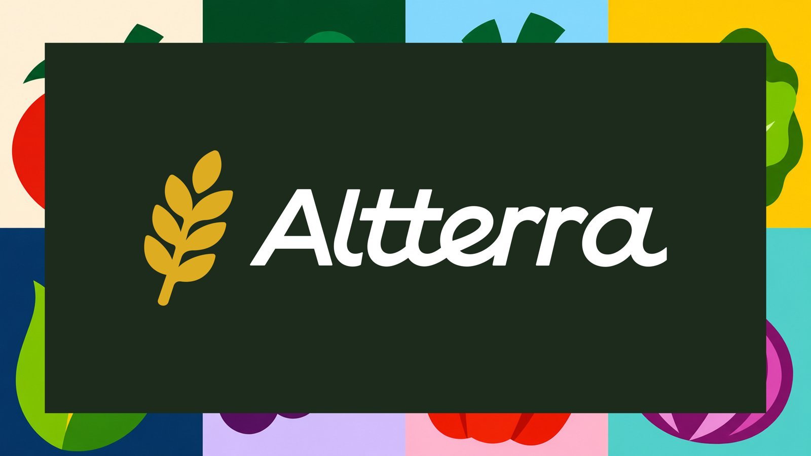

# Altterra

O Altterra é um marketplace B2B que liga quem produz alimentos a quem compra em volume: mercados, restaurantes, cozinhas industriais e distribuidores. O produtor vende sem intermediário, o comprador sabe de onde vem cada lote, e o que sobra da colheita ganha destino em vez de ir para o lixo.

O projeto foi desenvolvido pelo Grupo GLYFFS ao longo do 1º ano de Engenharia de Software da FIAP e está ligado ao ODS 2 (Fome Zero e Agricultura Sustentável).

## Links

- **Site:** https://grupo-glyffs.github.io/Altterra/
- **Vídeo da Fase 7:** https://vimeo.com/1249883412

## Os três pilares

- **Marketplace Direto:** compra em atacado direto de produtores, cooperativas e distribuidores, com preço por faixa de volume e pedido mínimo definidos por cada fornecedor.
- **Outlet Sustentável:** lotes fora do padrão de tamanho ou de aparência, com a mesma qualidade e preço menor. No site, o Outlet é um filtro da busca e um selo dourado nos produtos.
- **Safra que Alimenta:** o fornecedor doa o excedente da colheita para bancos de alimentos, cozinhas comunitárias e abrigos cadastrados. As doações aparecem no perfil e na loja de quem doou.

## O que dá para fazer no site

**Como comprador**
- Buscar produtos por nome, categoria e região, ordenar os resultados e filtrar só o Outlet.
- Ver a página do produto com as faixas de preço por volume, o frete, a localização no mapa e as avaliações.
- Montar o carrinho, que separa os itens por fornecedor, cada um com o seu frete.
- Finalizar o pedido numa página só: endereço (com o CEP preenchido pela API ViaCEP), entrega, pagamento por Pix ou boleto e revisão.
- Acompanhar os pedidos, avaliar o fornecedor quando o pedido chega e guardar produtos e fornecedores nos favoritos.

**Como fornecedor**
- Cadastrar um produto em etapas, com fotos, faixas de preço, estoque e a opção de Outlet, vendo a prévia do anúncio ao vivo.
- Editar, pausar e excluir anúncios.
- Receber pedidos e avançar o status de cada um.
- Doar o excedente pelo Safra que Alimenta.

## Como abrir o app

1. **Pelo link:** https://grupo-glyffs.github.io/Altterra/
2. **Pelo arquivo:** na pasta do site (a pasta `dist`, que vai no zip da entrega), abra o `index.html` com dois cliques. Ele funciona direto no navegador, sem instalar nada.
3. **Pelo código-fonte:** com o Node.js instalado, rode `npm install` e depois `npm run dev`.

**Contas de teste:** o login fica salvo no próprio navegador, sem servidor.
- **Compradora:** já vem preenchida na tela de entrar. É só clicar em Entrar (`compras@mercadosaojorge.com.br`, senha `altterra123`).
- **Fornecedor:** `contato@valeverde.coop.br`, senha `altterra123`.

## Como foi feito

- **Design system próprio:** paleta em verde e dourado, tipografia Cal Sans UI, ícones Material Symbols e componentes desenhados uma vez e usados igual em todo o site (botões, campos, cards de produto, abas, selos e janelas).
- **React + Vite**, com as rotas do **React Router** (`HashRouter`, para funcionar no GitHub Pages e abrindo o `index.html` direto).
- **Mantine** como base dos componentes, com o tema do Altterra.
- **React Hook Form + yup** nos formulários, com os erros mostrados no próprio campo.
- **fetch + API ViaCEP** para preencher o endereço pelo CEP.
- **localStorage** para guardar a conta, o carrinho, os favoritos, os pedidos, os anúncios e as doações.
- **GitHub Actions** para publicar o site no GitHub Pages a cada atualização.

## Grupo GLYFFS

- Gabriel de Lucca Chiapetta Santana (RM573610)
- Leonardo de Lima Dias (RM569286)
- Fabricio Cardoso Nicoli (RM571627)
- Felipe Santos (RM574050)
- Samuel Almeida Santos (RM572554)

## Uso de IA

Usamos IA como apoio: Claude e Gemini no design e no código, ChatGPT nas imagens e ElevenLabs na voz do vídeo.
